I'm Yaroslav. This is my workshop for Python tools, Telegram bots, and game experiments in C#.

## On the workbench

- **Bots:** profiles, teammate search, and event workflows.
- **Small applications:** game data APIs and camera experiments.
- **Game modding:** item systems and probability-based mechanics.

## Selected projects

- **[FindTeamSystem](https://github.com/Dake69/FindTeamSystem)** — A Telegram bot for finding gaming teammates, with user profiles, search filters, and match tracking.
- **[school-project](https://github.com/Dake69/school-project)** — A Django REST API for game reference data, including heroes, items, structures, and creeps.
- **[ASCII-Webcam](https://github.com/Dake69/ASCII-Webcam)** — A webcam experiment that renders camera frames as ASCII and switches modes with a double clap or the spacebar.
- **[Stardew Casino Upgrader](https://github.com/Dake69/musorDropStardewValley)** — A single-player Stardew Valley mod with a searchable item browser and probability-based item upgrades.

## Tools in use

**Languages:** Python, C# 
**Bots, APIs & media:** aiogram, Django REST framework, MongoDB, OpenCV, NumPy 
**Game modding:** .NET, SMAPI
