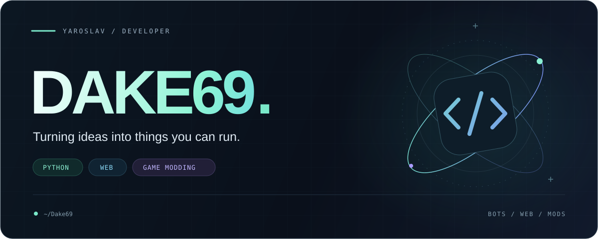
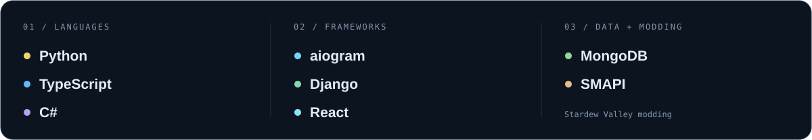
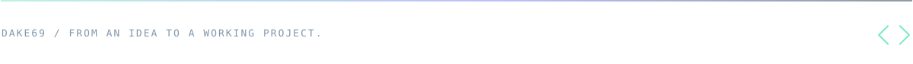

<p align="center">
  
</p>

<p align="center">
  <a href="#about">About</a> &nbsp;·&nbsp;
  <a href="#stack">Stack</a> &nbsp;·&nbsp;
  <a href="#selected-projects">Projects</a> &nbsp;·&nbsp;
  <a href="https://github.com/Dake69?tab=repositories">All repositories ↗</a>
</p>

<br />

## About

Hey, I'm **Yaroslav**, aka **Dake69**.

I build Telegram bots, explore web development, and make mods for Stardew Valley. My projects range from finding gaming teammates to turning a webcam feed into ASCII art.

```python
interests = {
    "bots":    "Useful tools, communities, and game mechanics",
    "web":     "Python backends and React interfaces",
    "modding": "New ways to play familiar games",
}
```

<br />

## Stack



<br />

## Selected projects

<table>
  <tr>
    <td width="50%" valign="top">
      <h3>01 / FindTeamSystem</h3>
      <p>A Telegram bot that helps gamers find teammates, with profiles, filters, and matchmaking.</p>
      <p><code>Python</code> <code>aiogram</code> <code>MongoDB</code></p>
      <p><a href="https://github.com/Dake69/FindTeamSystem">Explore the project ↗</a></p>
    </td>
    <td width="50%" valign="top">
      <h3>02 / MUSOR DROP</h3>
      <p>A Stardew Valley mod with an item-upgrade mechanic, a custom interface, and an animated wheel.</p>
      <p><code>C#</code> <code>.NET</code> <code>SMAPI</code></p>
      <p><a href="https://github.com/Dake69/musorDropStardewValley">Explore the project ↗</a></p>
    </td>
  </tr>
  <tr>
    <td width="50%" valign="top">
      <h3>03 / ASCII Webcam</h3>
      <p>Live webcam-to-ASCII rendering, with a double clap to switch modes.</p>
      <p><code>Python</code> <code>OpenCV</code> <code>NumPy</code></p>
      <p><a href="https://github.com/Dake69/ASCII-Webcam">Explore the project ↗</a></p>
    </td>
    <td width="50%" valign="top">
      <h3>04 / School Project</h3>
      <p>A web project with a Python backend and a separate React frontend written in TypeScript.</p>
      <p><code>Python</code> <code>React</code> <code>TypeScript</code></p>
      <p><a href="https://github.com/Dake69/school-project">Backend ↗</a> &nbsp;·&nbsp; <a href="https://github.com/Dake69/school-project-frontend">Frontend ↗</a></p>
    </td>
  </tr>
</table>

<br />

<p align="center">
  <a href="https://github.com/Dake69?tab=repositories"><strong>There's more in the repositories →</strong></a>
</p>

<br />


